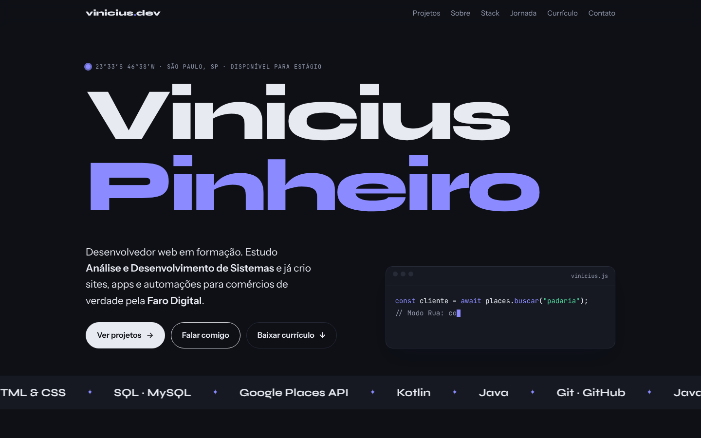
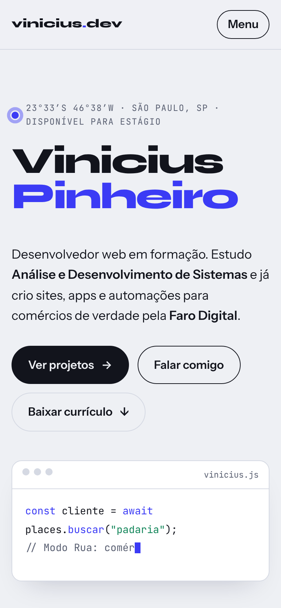

# Portfólio

Meu site pessoal: projetos, stack, trajetória e currículo em uma página.

**No ar:** [site.viniciuspinheiro.workers.dev](https://site.viniciuspinheiro.workers.dev/)





## Como foi feito

- **Um único `index.html`**, com HTML, CSS e JavaScript puros, sem framework nem build. Carrega rápido e é simples de publicar.
- **Animações leves em CSS e JavaScript** (texto digitado no bloco de código, faixa de tecnologias em movimento, entrada das seções), todas desligadas para quem ativa "reduzir movimento" no sistema (`prefers-reduced-motion`).
- **Prévia ao compartilhar:** tags Open Graph com imagem própria para o link aparecer bem no WhatsApp e no LinkedIn.
- **Currículo em PDF** disponível para download na própria página.
- **Hospedagem na Cloudflare.**

## Rodando localmente

```bash
python -m http.server 8000
```
